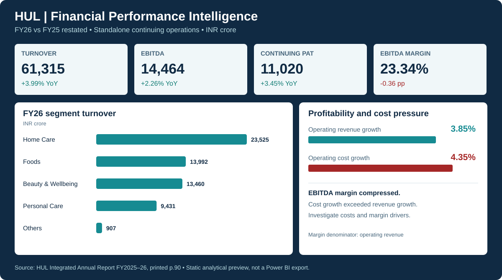

# HUL | Financial Performance Intelligence

**Financial analytics · Excel · Power BI-ready model · FMCG**

> Status: verified source data, KPI analysis, static summary and executive case study published. Power BI Desktop implementation and native PBIX export are pending. Excel workbook created locally; binary upload pending.

## Business problem

Assess whether growth is translating into operating profitability, identify segment growth contributions, and distinguish recurring operations from tax and exceptional effects.

## Key findings

- Turnover grew **3.99%** to INR 61,315 crore.
- EBITDA rose **2.26%** to INR 14,464 crore, while EBITDA / operating revenue fell from 23.70% to 23.34%.
- Operating costs increased **4.35%**, ahead of operating revenue growth of 3.85%.
- Home Care accounted for **30.51%** of the INR 2,350 crore turnover increase; Beauty & Wellbeing led segment turnover growth (4.98%).
- Continuing PAT increased 3.45%, while pre-exceptional PBT grew only 0.18%; lower tax expense contributed materially to the PAT increase.

See [executive case study](docs/executive-case-study.md) for recommendations, limitations and PAT bridge.

## Deliverables

| File | Purpose |
| --- | --- |
| [Financial.csv](data/Financial.csv) | Source-linked comparable P&L |
| [Segments.csv](data/Segments.csv) | Source-linked segment data |
| [Historical.csv](data/Historical.csv) | FY24–25 originally reported historical context only |
| [Year.csv](data/Year.csv) | Power BI year dimension |
| [Source register](docs/source-register.csv) | Provenance and reporting basis |
| [DAX measures](dashboard/measures.dax) | Power BI model calculations |
| [Theme](dashboard/theme.json) | Power BI styling |
| [Build guide](dashboard/docs/build-guide.md) | Reproduce three report pages and validate |
| [Static preview](dashboard/financial-summary.svg) | Verified-data summary; not a Power BI screenshot |
| [Executive case study](docs/executive-case-study.md) | Findings and business recommendations |

## Methodology and quality

Use FY25 restated and FY26 standalone continuing operations from the FY26 report (printed p.90). Ice Cream was demerged effective 1 December 2025; the FY25 originally reported figures are retained separately, not mixed with restated numbers. All amounts are INR crore; costs are positive expense magnitudes. Margins use operating revenue; segment shares use turnover. Eighteen arithmetic reconciliation checks (nine per year) yield zero variance. This is not an independent audit.

## Official sources

- [FY26 annual report](https://www.hul.co.in/files/annual-report-2025-26-single-page.pdf) — Financial Review, printed p.90.
- [FY25 annual report](https://www.hul.co.in/files/hul-integrated-annual-report-2024-25.pdf) — Results, historical context.

## Reproduce
Download the CSVs, import into Excel or Power BI Desktop, and follow the build guide. Add the native PBIX and exported screenshots after validation. Aggregate annual data cannot establish causal cost drivers or reliable forecasts.

Independent AI-assisted educational portfolio project; not affiliated with HUL. Author: Sourav Gupta (MBA Business Analytics). [LinkedIn](https://www.linkedin.com/in/souravguptaanalyst/).
