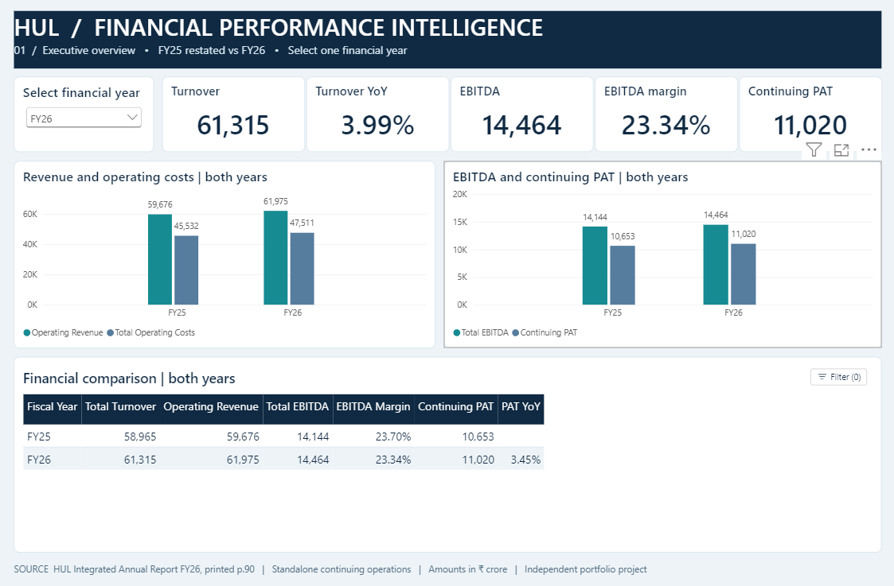
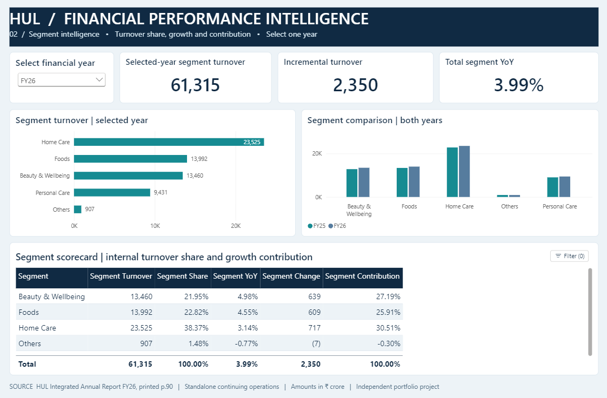
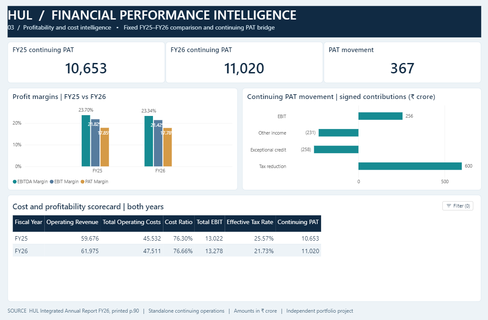

# Power BI Desktop | Dashboard gallery

[Download editable project ZIP](HUL_PowerBI_Project.zip) · [Validation results](desktop-validation.md) · [Back to case study](../README.md)

Extract the ZIP, open `HUL_Financial_Intelligence.pbip` in Power BI Desktop, and select FY26 on the first two pages. Source data is embedded. This is an editable local report, not an online Power BI Service link.

## 01 — Executive overview

## 02 — Segment intelligence

## 03 — Profitability and cost

Screenshots were cropped from the participant's actual Desktop report. Selected values and visuals were checked on 25 November 2026. The segment scorecard requires scrolling for the fifth row. FY25 YoY is blank by design. Native PBIX export and exhaustive interaction testing are not included. Independent AI-assisted portfolio project.
